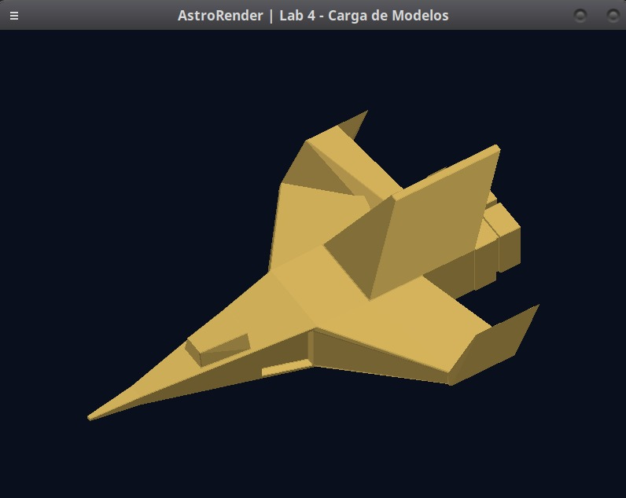

# 🚀 ASTRO//RENDER

<div align="center">

### 🛸 3D Software Renderer · Rust · Blender

**Renderizador 3D por software desarrollado en Rust para visualizar modelos OBJ mediante rasterización de triángulos.**


**Universidad del Valle de Guatemala · Gráficas por Computadora · 2026**

</div>

---

## 🚀 El proyecto

**AstroRender** es un renderizador tridimensional por software desarrollado en Rust como parte del laboratorio de Carga de Modelos del curso Gráficas por Computadora.

El programa carga una nave espacial creada en Blender y exportada en formato OBJ. A partir de los vértices y las caras del modelo, realiza la rasterización de triángulos y muestra la nave en pantalla.

La aplicación permite rotar el modelo mediante el teclado, visualizarlo desde diferentes perspectivas y mantenerlo centrado dentro de la ventana.

## 🛸 Resultado

<div align="center">



*Modelo 3D renderizado en AstroRender.*

</div>

## 🛠️ Tecnologías

| Tecnología | Uso |
|---|---|
| **Rust** | Desarrollo del renderizador |
| **Blender 5.2 LTS** | Modelado de la nave espacial |
| **minifb** | Ventana gráfica |
| **Wavefront OBJ** | Geometría del modelo 3D |
| **Cargo** | Compilación y dependencias |
| **Git y GitHub** | Control de versiones |

## ✨ Características

- Carga de modelos OBJ.
- Rasterización de triángulos.
- Framebuffer y Z-buffer.
- Centrado y escalado automático.
- Rotación interactiva.
- Iluminación básica.
- Visualización en una ventana de 800 × 600 píxeles.

## 🎮 Controles

| Tecla | Acción |
|---|---|
| ⬅️ / ➡️ | Rotación horizontal |
| ⬆️ / ⬇️ | Rotación vertical |
| **R** | Reiniciar vista |
| **Esc** | Salir |

## 💻 Ejecución

Clonar el repositorio:

```bash
git clone https://github.com/Anaru03/AstroRender.git
cd AstroRender
```

Ejecutar el proyecto:

```bash
cargo run --release
```

Ejecutar las pruebas:

```bash
cargo test
```

---

<div align="center">

**ASTRO//RENDER**

*From vertices to pixels.*

**UVG · Gráficas por Computadora · 2026**

</div>